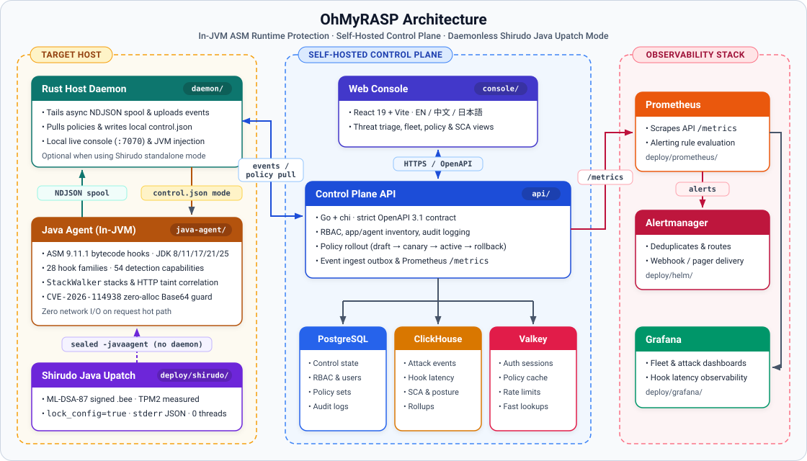

# OhMyRASP

Self-hosted Java RASP built on ASM bytecode instrumentation, `StackWalker` call-stack analysis, and request-parameter correlation. Runs inside the JVM across JDK 8, 11, 17, 21, and 25, either paired with a Rust host daemon and Go/React control plane, or standalone as signed [shirudo](https://github.com/shirudo-dev/shirudo) Java upatches.

[](https://github.com/xuing/oh-my-rasp/actions/workflows/ohmyrasp-control.yml)
[](https://github.com/xuing/oh-my-rasp/releases)
[](LICENSE)
[](java-agent/)
[](docs/development/vulhub-coverage.md)

**Languages:** English | [简体中文](README.zh-CN.md)

## Try the local demo

Start Tomcat 11 with the agent in `block` mode and the Rust daemon's local console (first source build typically takes 1–2 minutes depending on network and CPU):

```bash
cd java-agent
docker compose -f docker-compose.daemon.yml up -d --build --wait

# Send a SQL injection payload
curl -i -G --data-urlencode "value=' OR '1'='1" "http://localhost:18090/rasp/sql"
# -> HTTP/1.1 302 redirecting to /rasp/blocked?hook=sql&algorithm=sql_userinput&message=SQL+query+structure+appears+altered+by+request+input

# Query recent attack events from the daemon API
curl -s "http://localhost:7070/api/events?limit=5"
```

Open `http://localhost:7070` in a browser for the daemon's live attack events, hook latency, and runtime mode switching (`off` / `monitor` / `block`).

> The demo app uses port `18090`, which is also the control-plane API port. Set `OHMYRASP_DEMO_PORT` if you run both together.

> The mode lives in `control.json` on the demo's volume and survives restarts. If the attack returns `200 rows=1` instead of `302`, the volume still holds `monitor` from an earlier run or a console switch: reset it with `docker compose -f docker-compose.daemon.yml down -v`.

For a side-by-side baseline vs. protected comparison across Tomcat 9, 10, and 11, see [docs/getting-started.md](docs/getting-started.md).

## When to use OhMyRASP

OhMyRASP fits self-hosted Java services on JDK 8, 11, 17, 21, or 25 where you want sink-level blocking inside the JVM, optionally backed by host-daemon telemetry and a centralized policy console, or deployed daemonless via shirudo.

**Trade-offs and limits:**

- **Signature-based detection, not bytecode taint tracking:** Sinks correlate arguments against `ThreadLocal<RequestContext>` request parameters via substring matching and inspect live call stacks. Arbitrary multi-hop string transformations or async executor boundaries without HTTP context are outside taint correlation unless covered by a stack or sink rule.
- **JVM-process trust boundary:** A `-javaagent` runs inside the JVM it protects. `root` or the JVM-launching user can omit `-javaagent` or override environment variables unless you deploy signed shirudo JARs (`lock_config=true`) alongside kernel enforcement (such as shirudo BPF upatches).
- **Pre-release status:** OhMyRASP is experimental pre-1.0 software. APIs, policy schemas, and packaging formats may change before `1.0`.

## By the numbers

Every hook, detector, and Vulhub replay script lives in this repository and runs in CI.

<!-- BEGIN GENERATED metrics (java-agent/scripts/gen-detection-coverage.py) — do not edit between markers -->
| Metric | Value | Source |
|---|---|---|
| Instrumented sink families | 28 ASM hook modules (`agent-jdk25`); 24 ASM transformers per backport (`java8`, `java11`, `java17`) | [DETECTION-COVERAGE.md](java-agent/docs/DETECTION-COVERAGE.md) |
| Detection engine | 56 `DetectorEngine` capabilities, 43 verified algorithm signatures asserted end-to-end | [DETECTION-COVERAGE.md](java-agent/docs/DETECTION-COVERAGE.md) |
| Exploit replay suite | 136 scenarios across 53 [Vulhub](https://github.com/vulhub/vulhub) roots (130 CVEs tracked) | [vulhub-coverage.md](docs/development/vulhub-coverage.md) |
| Benign corpus precision | `0 / 175` false positives across 22 categories | [FALSE-POSITIVE-REPORT.md](java-agent/docs/FALSE-POSITIVE-REPORT.md) |
| Supported JVMs | Builds for JDK 8, 11, 17, and a shared JDK 21/25 build (`javax.servlet` & `jakarta.servlet`) | [docs/agent.md](docs/agent.md) |
<!-- END GENERATED metrics -->

**Verified CVEs and exploit classes blocked:**
- **OpenJDK Base64 AVX-512 tail-underflow (Java2Shell / Java4Shell, CVE-2026-114938)** across JDK 8–25
- **JNDI & Deserialization:** Log4Shell (CVE-2021-44228), Fastjson `autoType` and [1.2.83 `getResourceAsStream`](https://github.com/midisec/fastjson-1.2.83-gadget-rce), Shiro `rememberMe` (CVE-2016-4437), ActiveMQ OpenWire (CVE-2023-46604), XStream, WebLogic XMLDecoder
- **Expression & Template RCE:** Struts2 OGNL advisories (S2-001 and later), Spring4Shell (CVE-2022-22965), Spring Cloud Gateway SpEL (CVE-2022-22947), GeoServer (CVE-2024-36401), DataEase (2024–2025)
- **Servlet, File & SQL:** Tomcat Ghostcat (CVE-2020-1938), Shiro/GlassFish/Jetty path confusion, standalone & driver-wide JDBC `Statement` SQLi

## How detection works

OhMyRASP intercepts execution inside JDK sinks rather than matching regexes on HTTP payloads at a proxy:

- **Request-parameter correlation:** Process execution and SQL sinks check whether suspect arguments match live HTTP request parameters via `ThreadLocal<RequestContext>` substring checks, separating attacker input from scheduled internal jobs.
- **`StackWalker` call-stack classification:** At sinks such as `ProcessBuilder.start`, the agent inspects live stack frames to distinguish Struts2 OGNL, Spring SpEL, MVEL, Groovy, and XStream gadget chains from normal application calls.
- **Six-form path confusion decoding:** Incoming URIs are normalized simultaneously across raw, single-decoded, double-decoded, low-byte Unicode, overlong UTF-8, and lenient percent forms to catch traversal mismatches without per-framework rules.
- **Cryptographic token checks:** Default-secret JWTs are verified by real HMAC execution, and Shiro `rememberMe` cookies are decrypted under known default keys to check for Java serialization magic bytes.
- **Zero-allocation Java2Shell guard (CVE-2026-114938):** Instruments `java.util.Base64$Decoder.decode0` with a pure arithmetic boundary check (`length >= 65`, `1 <= (length & 63) <= 3`, `1 <= padding <= 2`, `padding <= remainder`, strict Base64 alphabet, `!isMIME`) before the native x86-64 AVX-512 stub can write out of bounds. Fires even outside HTTP requests and logs metadata only.
- **Fastjson 1.2.83 class-resource boundary:** Hooks `ClassLoader.getResourceAsStream` inside `ParserConfig.checkAutoType` to block remote (`http(s)://`, `jar:http(s)://`) and `jar:file:/proc/self/fd/` gadgets while keeping normal classpath and Spring Boot `jar:nested:` loads quiet.
- **Non-blocking hot path:** Findings queue asynchronously to a local NDJSON spool (`stderr` in shirudo standalone mode). Runtime mode switches (`off` / `monitor` / `block`) apply without restarting the JVM.

Full specification: [docs/detection.md](docs/detection.md).

## Shirudo Java Upatch Packages

OhMyRASP ships ready-to-sign **[shirudo](https://github.com/shirudo-dev/shirudo) Java upatch packages** in [`deploy/shirudo/`](deploy/shirudo/README.md) for targets managed by shirudo's pull-based, ML-DSA-87 signed, TPM2-measured deployment model.

| Package | Target JVMs | Upatch JAR | Gradle module |
|---|---|---|---|
| `ohmyrasp-java8` | Java 8 (classfile `<= 52`) | `ohmyrasp-java8.jar` | `:agent-java8` |
| `ohmyrasp-java11` | Java 11 (classfile `<= 55`) | `ohmyrasp-java11.jar` | `:agent-java11` |
| `ohmyrasp-java17` | Java 17 & Java 21 (classfile `<= 61`) | `ohmyrasp-java17.jar` | `:agent-java17` |
| `ohmyrasp-jdk21` | Java 21 (classfile `<= 65`) | `ohmyrasp-jdk21.jar` | `:agent-jdk25` |
| `ohmyrasp-jdk25` | Java 21 & Java 25 (classfile `<= 65`) | `ohmyrasp-jdk25.jar` | `:agent-jdk25` |

For JDK 21, download `ohmyrasp-agent-jdk21.jar` for the standard agent or `ohmyrasp-jdk21.jar` for Shirudo. Each is byte-for-byte identical to its JDK 25 counterpart.

Each shirudo JAR embeds `META-INF/ohmyrasp-shirudo.properties` (`standalone=true`, `lock_config=true`, `mode=block`, `control=none`, `log=stderr`, `latency_sample=0`):

- Starts **zero background threads** (no control-file poller, no spool writer).
- Ignores `/tmp/ohmyrasp-control.json` and hostile `OHMYRASP_MODE` / `OHMYRASP_CONTROL` overrides (`lock_config=true` is read strictly from the signed JAR).
- Emits structured JSON detections directly to `stderr` without creating `/tmp/ohmyrasp-events.jsonl` or `hook_latency` noise.

Build and sign all `.bee` packages from source, or grab `ohmyrasp-shirudo-upatches-<version>.tar.gz` from [GitHub Releases](https://github.com/xuing/oh-my-rasp/releases):

```sh
# Build & sign all .bee packages with your operator ML-DSA-87 keys
./deploy/shirudo/build-all.sh "<version>" --keys-dir "<keys>"

# Or build JARs only and run Beefile/JAR checks + Temurin 8/11/17/21/25 smoke tests
./deploy/shirudo/build-all.sh --jar-only
./deploy/shirudo/verify-shirudo-upatch.sh
./deploy/shirudo/smoke-test.sh
```

See [deploy/shirudo/README.md](deploy/shirudo/README.md) for `shirudo bpm install`, Java 8 `JAVA_TOOL_OPTIONS` limits, container bind-mounts, and security boundaries.

## Quick Start

### Option A: Download pre-built artifacts

Each release on [GitHub Releases](https://github.com/xuing/oh-my-rasp/releases) publishes the standard Java agent JARs, the standalone shirudo upatch JARs and Shirudo bundle, the Rust daemon tarball, the Helm chart archive, and `SHA256SUMS.txt`; the full asset list is in the [release runbook](docs/runbooks/release.md).

Container images (`ghcr.io/xuing/control-api`, `ghcr.io/xuing/control-web`) and the OCI Helm chart (`oci://ghcr.io/xuing/charts/ohmyrasp-control`) are published alongside the release assets. Verify checksums and GitHub artifact attestations before deploying:

```bash
VERSION="<version>"   # the release you downloaded, without the leading v
sha256sum -c SHA256SUMS.txt
gh attestation verify "ohmyrasp-shirudo-upatches-${VERSION}.tar.gz" -R xuing/oh-my-rasp
gh attestation verify "ohmyrasp-control-${VERSION}.tgz" -R xuing/oh-my-rasp
```

### Option B: Build the agent locally (Docker only)

```bash
cd java-agent
GRADLE_IMAGE="$(awk '$1 == "FROM" && $2 ~ /^gradle:/ { print $2; exit }' Dockerfile)"
docker run --rm -u "$(id -u):$(id -g)" -e GRADLE_USER_HOME=/tmp/gradle-home \
  -v "$PWD":/workspace -w /workspace "$GRADLE_IMAGE" \
  gradle --no-daemon :agent-jdk25:agentJar
# -> agent-jdk25/build/libs/ohmyrasp-agent.jar
```

Use `:agent-java8:agentJava8Jar`, `:agent-java11:agentJava11Jar`, or `:agent-java17:agentJava17Jar` for earlier JDKs, or `:agent-*:shirudoUpatchJar` for daemonless shirudo builds.

### Attach to an application

Standalone (no control plane):

```bash
java -javaagent:/opt/ohmyrasp/ohmyrasp-agent.jar=mode=monitor \
     -Dohmyrasp.log=/var/log/ohmyrasp/events.jsonl \
     -jar your-app.jar
```

With the full self-hosted control plane:

```bash
cp .env.example .env
# Fill empty secrets in .env (e.g. openssl rand -hex 18)
docker compose --env-file .env -f docker-compose.yml up -d --build
```

| Service | Default URL |
|---|---|
| Web console | `http://<host>:18091` |
| Control API | `http://<host>:18090` |
| Grafana / Prometheus / Alertmanager | `:13000` / `:19090` / `:19093` |
| ClickHouse HTTP | `http://<host>:18123` |

Sign in as `admin@ohmyrasp.local` with `OHMYRASP_BOOTSTRAP_ADMIN_PASSWORD`, create an application to obtain `app_id` and `app_secret`, then start your JVM:

```bash
java -javaagent:/opt/ohmyrasp/ohmyrasp-agent.jar=backend_url=http://<host>:18090,app_id=<app-id>,app_secret=<secret>,environment_id=<env-id>,mode=block \
     -jar your-app.jar
```

Full walkthrough: [docs/getting-started.md](docs/getting-started.md).

## Architecture



| Component | Stack | Role |
|---|---|---|
| `java-agent/` | Java 8/11/17/25, ASM (shaded) | In-JVM sink hooks, detection engine, NDJSON spool, shirudo standalone JARs |
| `daemon/` | Rust (edition 2024) | Tails agent spools, forwards events, serves local live console, injects agents |
| `api/` | Go, OpenAPI 3.1 | RBAC, app/fleet inventory, policy rollout/canary/rollback, telemetry ingestion |
| `console/` | React, Vite, TypeScript, Tailwind CSS | Fleet dashboards, threat triage, policy editor, latency & posture views (EN/中文/日本語) |
| `deploy/` | Helm, Compose, shirudo | Kubernetes Helm chart, observability assets, [shirudo Java upatch packages](deploy/shirudo/README.md) |

More detail: [docs/architecture.md](docs/architecture.md).

## Development & Documentation

```bash
# Go control plane
GO_IMAGE="$(awk '$1 == "FROM" && $2 ~ /^golang:/ { print $2; exit }' api/Dockerfile)"
docker run --rm -v "$PWD/api":/src -w /src "$GO_IMAGE" go test ./...

# Web console
(cd console && npm ci && npm run build && npm test)

# Rust daemon
(cd daemon && cargo test --locked)

# Java agent unit tests + Vulhub Docker acceptance suite
GRADLE_IMAGE="$(awk '$1 == "FROM" && $2 ~ /^gradle:/ { print $2; exit }' java-agent/Dockerfile)"
docker run --rm -v "$PWD/java-agent":/workspace -w /workspace "$GRADLE_IMAGE" \
  gradle --no-daemon :agent-jdk25:check
(cd java-agent && bash scripts/acceptance.sh)

# Shirudo upatch Beefile/JAR checks + Temurin 8/11/17/21/25 smoke tests
./deploy/shirudo/build-all.sh --jar-only
./deploy/shirudo/verify-shirudo-upatch.sh
./deploy/shirudo/smoke-test.sh
```

- [Documentation index](docs/README.md) · [Getting started](docs/getting-started.md) · [Architecture](docs/architecture.md) · [Detection engine](docs/detection.md)
- [Java agent](docs/agent.md) · [Shirudo upatch packages](deploy/shirudo/README.md) · [Console](docs/console.md) · [API reference](docs/api-reference.md)
- [Operations runbooks](docs/runbooks/) · [Algorithm coverage](docs/development/algorithm-coverage.md) · [Vulhub coverage](docs/development/vulhub-coverage.md)
- [Contributing](CONTRIBUTING.md) · [Changelog](CHANGELOG.md) · [Security policy](SECURITY.md) (detection bypasses are explicitly in scope)

## Acknowledgements

Built on [ASM](https://asm.ow2.io/) for bytecode instrumentation, informed by [OpenRASP](https://github.com/baidu/openrasp), validated against [Vulhub](https://github.com/vulhub/vulhub), and packaged for [shirudo](https://github.com/shirudo-dev/shirudo).

## License

Apache License 2.0. See [LICENSE](LICENSE).
