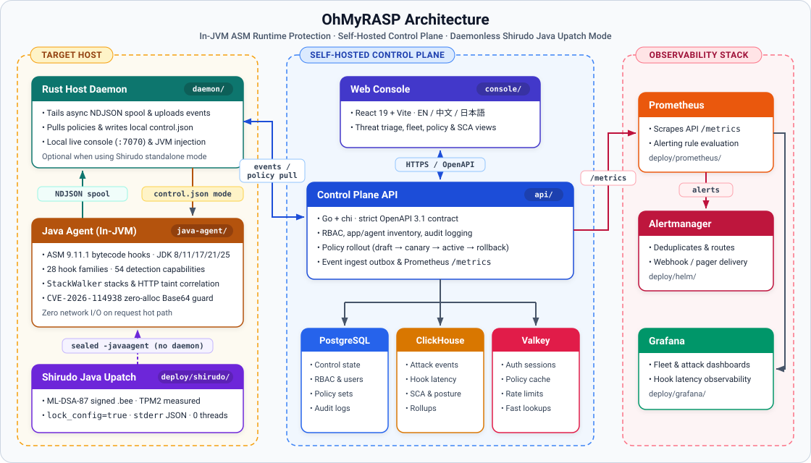

# OhMyRASP

基于 ASM 字节码插桩、`StackWalker` 调用栈分析与请求参数子串关联的自托管 Java RASP。覆盖 JDK 8、11、17、21 与 25，既可以配合 Rust Host Daemon 与 Go/React 控制平面集中管控，也可以作为签名 [shirudo](https://github.com/shirudo-dev/shirudo) Java upatch 在目标机上无守护进程独立运行。

[](https://github.com/xuing/oh-my-rasp/actions/workflows/ohmyrasp-control.yml)
[](https://github.com/xuing/oh-my-rasp/releases)
[](LICENSE)
[](java-agent/)
[](docs/development/vulhub-coverage.md)

**语言：** [English](README.md) | 简体中文

## 本地体验一次拦截

只需要 Docker，启动挂载 `block` 模式 agent 的 Tomcat 11 与 daemon 本地控制台（首次从源码构建通常需要 1–2 分钟，视网络与 CPU 而定）：

```bash
cd java-agent
docker compose -f docker-compose.daemon.yml up -d --build --wait

# 发送一条 SQL 注入载荷
curl -i -G --data-urlencode "value=' OR '1'='1" "http://localhost:18090/rasp/sql"
# -> 返回 HTTP/1.1 302，重定向至 /rasp/blocked?hook=sql&algorithm=sql_userinput&message=SQL+query+structure+appears+altered+by+request+input

# 从 daemon API 查询最近的攻击事件
curl -s "http://localhost:7070/api/events?limit=5"
```

在浏览器中打开 `http://localhost:7070` 可查看 daemon 实时攻击事件、hook 耗时及在线切换运行模式（`off` / `monitor` / `block`）。

> 演示应用默认占用 `18090` 端口（与控制平面 API 端口相同），同时运行两者时可通过 `OHMYRASP_DEMO_PORT` 改绑端口。

> 运行模式保存在演示卷的 `control.json` 中，重启后依然保留。如果攻击请求返回 `200 rows=1` 而不是 `302`，说明卷里还留着之前运行或在控制台切换时写入的 `monitor`：执行 `docker compose -f docker-compose.daemon.yml down -v` 即可重置。

如果需要 Tomcat 9 / 10 / 11 基线与受保护实例并排对比试验场，见 [docs/getting-started.md](docs/getting-started.md)。

## 适合你吗？（与边界取舍）

OhMyRASP 适合运行在 JDK 8、11、17、21 或 25 上的自托管 Java 服务：在 JVM 关键 sink 处执行阻断，按需接入本地守护进程与集中策略控制台，或通过 shirudo 无守护进程分发。

**边界与取舍：**

- **基于特征与子串关联，而非字节码数据流污点追踪：** 检测器在 sink 处通过 `ThreadLocal<RequestContext>` 进行请求参数子串匹配并分析实时调用栈；跨多层字符串变换或脱离 HTTP 上下文的异步执行链不会做字节码级数据流传播，除非命中调用栈或 sink 特征规则。
- **JVM 进程内信任边界：** `-javaagent` 运行在被保护 JVM 内部。`root` 或启动 JVM 的用户可以直接去掉 `-javaagent` 或覆盖未锁定环境变量；如需抗 `root` 篡改边界，需将签名 shirudo JAR（`lock_config=true`）与内核级强制策略（例如 shirudo BPF upatch）组合部署。
- **预发布阶段：** OhMyRASP 目前为实验性预发布软件，API、策略 schema 与打包格式在 `1.0` 前仍可能调整。

## 实测数据与漏洞覆盖

全部 hook、检测器与 Vulhub 回放脚本均在仓库内开源，并由 CI 持续回归。

<!-- BEGIN GENERATED metrics (java-agent/scripts/gen-detection-coverage.py) — do not edit between markers -->
| 维度 | 当前状态 | 依据 |
|---|---|---|
| 插桩调用点家族 | 31 个 ASM hook 模块（`agent-jdk25`）；回溯版（`java8` / `java11` / `java17`）各 25 个 ASM transformer | [DETECTION-COVERAGE.md](java-agent/docs/DETECTION-COVERAGE.md) |
| 检测引擎 | 42 项检测能力，验收脚本中有 176 个算法签名断言；另有 18 个规则 ID 已定义但未接入 hook，不计入 | [DETECTION-COVERAGE.md](java-agent/docs/DETECTION-COVERAGE.md) |
| 漏洞回放矩阵 | 136 个场景，覆盖 53 个 [Vulhub](https://github.com/vulhub/vulhub) 组件根（追踪 130 个 CVE） | [vulhub-coverage.md](docs/development/vulhub-coverage.md) |
| 正常语料误报率 | 27 类共 206 条真实构造正常输入，`0 / 206` 误报 | [FALSE-POSITIVE-REPORT.md](java-agent/docs/FALSE-POSITIVE-REPORT.md) |
| 运行时支持 | JDK 8、11、17 各有独立构建，21 和 25 共用主 Agent；兼容 `javax.servlet` 与 `jakarta.servlet` | [docs/agent.md](docs/agent.md) |
<!-- END GENERATED metrics -->

**已验证拦截的代表性漏洞：**
- **OpenJDK Base64 AVX-512 尾部越界写（Java2Shell / Java4Shell，CVE-2026-114938）**，覆盖 JDK 8–25
- **JNDI 与反序列化：** Log4Shell（CVE-2021-44228）、Fastjson `autoType` 与 [1.2.83 `getResourceAsStream`](https://github.com/midisec/fastjson-1.2.83-gadget-rce)、Shiro `rememberMe`（CVE-2016-4437）、ActiveMQ OpenWire（CVE-2023-46604）、XStream、WebLogic XMLDecoder
- **表达式与模板 RCE：** Struts2 OGNL 漏洞（S2-001 起）、Spring4Shell（CVE-2022-22965）、Spring Cloud Gateway SpEL（CVE-2022-22947）、GeoServer（CVE-2024-36401）、DataEase（2024–2025）
- **Servlet、文件与 SQL：** Tomcat 幽灵猫（CVE-2020-1938）、Shiro/GlassFish/Jetty 路径混淆绕过、独立应用及全驱动 JDBC `Statement` SQL 注入

## 检测引擎工作原理

OhMyRASP 不在网络边界对 HTTP 报文做正则猜谜，而是直接把检测点放在 JDK 关键 sink 内部：

- **请求参数子串关联：** 命令执行与 SQL 注入在 sink 处对照 `ThreadLocal<RequestContext>` 做请求参数子串匹配，确认参数源自实时 HTTP 请求才升级为阻断级告警，避免误伤内部定时任务。
- **`StackWalker` 调用栈结构分析：** 在 `ProcessBuilder.start` 等危险入口检查实时调用栈帧，准确区分 Struts2 OGNL、Spring SpEL、MVEL、Groovy、XStream 反序列化链与正常业务代码。
- **六重路径解码对比：** 将请求 URI 同时按原始、单次解码、两次解码、低字节 Unicode、超长 UTF-8 与宽松百分号解码归一化并交叉比对，用一个通用检测器覆盖多类路径混淆绕过。
- **真实密码学验签/解密：** 对可疑默认密钥 Bearer JWT 执行真实 HMAC 校验，对 Shiro `rememberMe` Cookie 用已知默认密钥解密并检查 Java 序列化魔数头。
- **Java2Shell 零分配算术快路径（CVE-2026-114938）：** 在 `java.util.Base64$Decoder.decode0` 入口执行纯算术条件检查（`length >= 65`、`1 <= (length & 63) <= 3`、`1 <= padding <= 2`、`padding <= remainder`、严格 Base64 字符集、`!isMIME`），在本地 AVX-512 stub 越界写发生前阻断恶意输入，脱离 HTTP 请求上下文也可生效，且仅记录长度等元数据。
- **Fastjson 1.2.83 类资源边界拦截：** 仅在 `ParserConfig.checkAutoType` 调用栈内拦截 `ClassLoader.getResourceAsStream`，阻断 `http(s)://`、`jar:http(s)://` 及 `jar:file:/proc/self/fd/` 等外部资源加载，放行正常 classpath 与 Spring Boot `jar:nested:`。
- **各 Java 版本相同的阻断范围：** 所有 Agent 版本线以同一方式判断检测结果是否位于 HTTP 请求之内（包括请求交给其他线程执行的工作），以及请求之外它说明了什么。参数本身就是攻击载荷的检测（远程 JNDI 名称、流中的利用链类）在阻断模式下处处阻断；其余检测（包括远程类、远程 DTD 和云元数据地址）在请求之外默认阻断，但云厂商自身的凭证客户端读取实例元数据时只记录。将 `outside_request` 设为 `log`（在控制台“防护配置”页按应用或环境设置、在主机控制台设置，或烘焙进独立 JAR）后，这些检测只记录、操作照常执行。[请求之外](docs/detection.md#outside-an-http-request)
- **热路径非阻塞写盘：** 告警异步进入本地 NDJSON spool（shirudo 独立模式下直接写 `stderr`），运行模式（`off` / `monitor` / `block`）可热切换而无需重启 JVM。

完整技术细节见 [docs/detection.md](docs/detection.md)。

## Shirudo Java Upatch 独立包

对于使用 **[shirudo](https://github.com/shirudo-dev/shirudo)** 拉取式、ML-DSA-87 签名、TPM2 度量体系的 Linux 目标机，OhMyRASP 在 [`deploy/shirudo/`](deploy/shirudo/README.md) 提供了开箱可签的 **Shirudo Java Upatch 打包方案**：

只需安装一个包：**`ohmyrasp`**。它包含全部 Agent 线路，主机上每个 JVM（Java 8 到 Java 25）都会启动与自身 Java 版本匹配的那一条。没有匹配线路的 JVM 只会向 `stderr` 写一行 JSON 并在无保护下启动，启动器从不中止 JVM。同一台主机上再装其他 OhMyRASP 包也无妨：每个 JVM 只会启动一条线路。

| 包名 | 启动于 | Upatch / JAR 文件名 | Gradle 模块 |
|---|---|---|---|
| **`ohmyrasp`**（默认） | Java 8 到 25，按版本选线路 | `ohmyrasp.jar` | `:agent-all` |
| `ohmyrasp-java8` | 仅 Java 8 | `ohmyrasp-java8.jar` | `:agent-java8` |
| `ohmyrasp-java11` | Java 11 及更高 | `ohmyrasp-java11.jar` | `:agent-java11` |
| `ohmyrasp-java17` | Java 17 及更高 | `ohmyrasp-java17.jar` | `:agent-java17` |
| `ohmyrasp-jdk21` | Java 21 及更高 | `ohmyrasp-jdk21.jar` | `:agent-jdk25` |
| `ohmyrasp-jdk25` | Java 21 及更高 | `ohmyrasp-jdk25.jar` | `:agent-jdk25` |

按 Java 版本拆分的包适用于只运行单一 Java 版本的主机。通用包还在其 Beefile 的 `fixes` 字段中列出了 Agent 已能阻断其测试过的利用路径的漏洞公告（由 shirudo 后端读取），清单见 [deploy/shirudo/ohmyrasp/README.md](deploy/shirudo/ohmyrasp/README.md)。

JDK 21 的标准 Agent 下载名为 `ohmyrasp-agent-jdk21.jar`，Shirudo 包使用 `ohmyrasp-jdk21.jar`。两者分别与对应的 JDK 25 产物逐字节一致。

该系列包内置 `META-INF/ohmyrasp-shirudo.properties`（`standalone=true`、`lock_config=true`、`mode=block`、`control=none`、`log=stderr`、`latency_sample=0`）：

- **零后台线程**：不启动控制文件轮询线程与本地写盘线程。
- **防配置降级**：`lock_config=true` 只从已签名 JAR 内部加载，目标机上的 `/tmp/ohmyrasp-control.json` 或 `OHMYRASP_MODE=off` 等环境变量均无法关闭阻断。
- **请求之外同样阻断**：HTTP 请求之外的检测结果与请求内一样被阻断，云厂商自身的凭证客户端读取实例元数据和主线少数按请求定义的规则除外（[请求之外](docs/detection.md#outside-an-http-request)）。通用包 `ohmyrasp.jar` 还会烘焙 `outside_request`（默认 `block`，构建时加 `--outside-request log` 则为 `log`）。
- **零落盘噪声**：结构化 JSON 检测事件直接输出到 JVM `stderr`，不在 `/tmp` 生成 `ohmyrasp-events.jsonl`，也不打印 `hook_latency` 采样。

你可以从 [GitHub Releases](https://github.com/xuing/oh-my-rasp/releases) 直接下载预构建的 `ohmyrasp-shirudo-upatches-<version>.tar.gz`，或在本地构建并运行实机容器冒烟测试：

```sh
# 使用 Operator 的 ML-DSA-87 私钥构建并签名全部 .bee 包
./deploy/shirudo/build-all.sh "<version>" --keys-dir "<keys>"

# 或仅构建 JAR 并运行 Beefile 校验与 Temurin 8/11/17/21/25 容器冒烟测试
./deploy/shirudo/build-all.sh --jar-only
./deploy/shirudo/verify-shirudo-upatch.sh
./deploy/shirudo/smoke-test.sh
```

`shirudo bpm install`、Java 8 `JAVA_TOOL_OPTIONS` 1024 字节限制、容器挂载方式及安全边界详见 [deploy/shirudo/README.md](deploy/shirudo/README.md)。

## 快速开始

### 方式 A：下载预构建 Release 制品

每个 [GitHub Releases](https://github.com/xuing/oh-my-rasp/releases) 版本会发布通用 Agent JAR `ohmyrasp-agent-all.jar`（首选）与按线路拆分的标准 Java Agent JAR、通用 Shirudo upatch JAR `ohmyrasp.jar` 与按线路拆分的 Shirudo 独立 Java upatch JAR 及 Shirudo 打包制品、Rust 守护进程压缩包、Helm Chart 压缩包以及 `SHA256SUMS.txt`；完整资产清单见[发布手册](docs/runbooks/release.md)。

同时发布 GHCR 容器镜像（`ghcr.io/xuing/control-api`、`ghcr.io/xuing/control-web`）与 OCI Helm Chart（`oci://ghcr.io/xuing/charts/ohmyrasp-control`）。部署前请校验哈希与 GitHub 构建证明：

```bash
VERSION="<version>"   # 下载的 Release 版本号，不含开头的 v
sha256sum -c SHA256SUMS.txt
gh attestation verify "ohmyrasp-shirudo-upatches-${VERSION}.tar.gz" -R xuing/oh-my-rasp
gh attestation verify "ohmyrasp-control-${VERSION}.tgz" -R xuing/oh-my-rasp
```

### 方式 B：本地构建 Agent（仅需 Docker）

```bash
cd java-agent
GRADLE_IMAGE="$(awk '$1 == "FROM" && $2 ~ /^gradle:/ { print $2; exit }' Dockerfile)"
docker run --rm -u "$(id -u):$(id -g)" -e GRADLE_USER_HOME=/tmp/gradle-home \
  -v "$PWD":/workspace -w /workspace "$GRADLE_IMAGE" \
  gradle --no-daemon :agent-all:agentAllJar
# -> agent-all/build/libs/ohmyrasp-agent-all.jar
```

`ohmyrasp-agent-all.jar` 可在 Java 8 到 25 上运行。只需 Java 21 及更高线路的 JAR 请构建 `:agent-jdk25:agentJar`；只需某一条旧线路请构建 `:agent-java8:agentJava8Jar`、`:agent-java11:agentJava11Jar` 或 `:agent-java17:agentJava17Jar`；通用的无守护进程 shirudo JAR（`ohmyrasp.jar`）使用 `:agent-all:shirudoUpatchJar`，按线路拆分的使用 `:agent-*:shirudoUpatchJar`。

### 挂载到目标应用

独立运行（无需控制平面）：

```bash
java -javaagent:/opt/ohmyrasp/ohmyrasp-agent-all.jar=mode=monitor \
     -Dohmyrasp.log=/var/log/ohmyrasp/events.jsonl \
     -jar your-app.jar
```

接入自托管控制平面：

```bash
cp .env.example .env
# 填写 .env 中的空白密钥（可用 openssl rand -hex 18 生成）
docker compose --env-file .env -f docker-compose.yml up -d --build
```

| 服务 | 默认地址 |
|---|---|
| Web 控制台 | `http://<host>:18091` |
| 控制平面 API | `http://<host>:18090` |
| Grafana / Prometheus / Alertmanager | `:13000` / `:19090` / `:19093` |
| ClickHouse HTTP | `http://<host>:18123` |

使用 `admin@ohmyrasp.local` 与 `OHMYRASP_BOOTSTRAP_ADMIN_PASSWORD` 登录控制台创建应用获取 `app_id` 与 `app_secret`，然后启动目标 JVM：

```bash
java -javaagent:/opt/ohmyrasp/ohmyrasp-agent-all.jar=backend_url=http://<host>:18090,app_id=<app-id>,app_secret=<secret>,environment_id=<env-id>,mode=block \
     -jar your-app.jar
```

完整操作见 [docs/getting-started.md](docs/getting-started.md)。

## 架构



| 模块 | 技术栈 | 职责 |
|---|---|---|
| `java-agent/` | Java 8/11/17/25, ASM（已 shade） | JVM 内置 hook、检测引擎、NDJSON spool、shirudo 独立包 |
| `daemon/` | Rust（edition 2024） | 跟踪 agent spool、上报事件、本地实时控制台、注入管理 |
| `api/` | Go, OpenAPI 3.1 | RBAC、应用与实例清单、策略下发/灰度/回滚、遥测摄入 |
| `console/` | React, Vite, TypeScript, Tailwind CSS | 概览仪表盘、威胁处置、策略编辑测试、延迟与基线视图（EN/中文/日本語） |
| `deploy/` | Helm, Compose, shirudo | Kubernetes Helm chart、可观测性资产、[shirudo Java upatch 包](deploy/shirudo/README.md) |

更多细节见 [docs/architecture.md](docs/architecture.md)。

## 开发与文档

```bash
# Go 控制平面
GO_IMAGE="$(awk '$1 == "FROM" && $2 ~ /^golang:/ { print $2; exit }' api/Dockerfile)"
docker run --rm -v "$PWD/api":/src -w /src "$GO_IMAGE" go test ./...

# Web 控制台
(cd console && npm ci && npm run build && npm test)

# Rust 守护进程
(cd daemon && cargo test --locked)

# Java agent 单元测试 + Vulhub Docker 验收矩阵
GRADLE_IMAGE="$(awk '$1 == "FROM" && $2 ~ /^gradle:/ { print $2; exit }' java-agent/Dockerfile)"
docker run --rm -v "$PWD/java-agent":/workspace -w /workspace "$GRADLE_IMAGE" \
  gradle --no-daemon :agent-jdk25:check
(cd java-agent && bash acceptance/runtime/jdk25.sh)

# Shirudo upatch Beefile/JAR 校验与 Temurin 8/11/17/21/25 容器冒烟测试
./deploy/shirudo/build-all.sh --jar-only
./deploy/shirudo/verify-shirudo-upatch.sh
./deploy/shirudo/smoke-test.sh
```

- [文档索引](docs/README.md) · [快速上手](docs/getting-started.md) · [系统架构](docs/architecture.md) · [检测深入解析](docs/detection.md)
- [Java agent](docs/agent.md) · [Shirudo Java upatch 包](deploy/shirudo/README.md) · [Web 控制台](docs/console.md) · [API 参考](docs/api-reference.md)
- [运维手册](docs/runbooks/) · [算法覆盖清单](docs/development/algorithm-coverage.md) · [Vulhub 回放清单](docs/development/vulhub-coverage.md)
- [贡献指南](CONTRIBUTING.md) · [变更日志](CHANGELOG.md) · [安全策略](SECURITY.md)（欢迎提交检测绕过报告）

## 致谢

Agent 基于 [ASM](https://asm.ow2.io/) 构建，借鉴了 [OpenRASP](https://github.com/baidu/openrasp) 的设计理念，通过 [Vulhub](https://github.com/vulhub/vulhub) 完成真实漏洞回归验证，并面向 [shirudo](https://github.com/shirudo-dev/shirudo) 提供原生 Java upatch 打包支持。

## 许可证

Apache License 2.0，详见 [LICENSE](LICENSE)。
