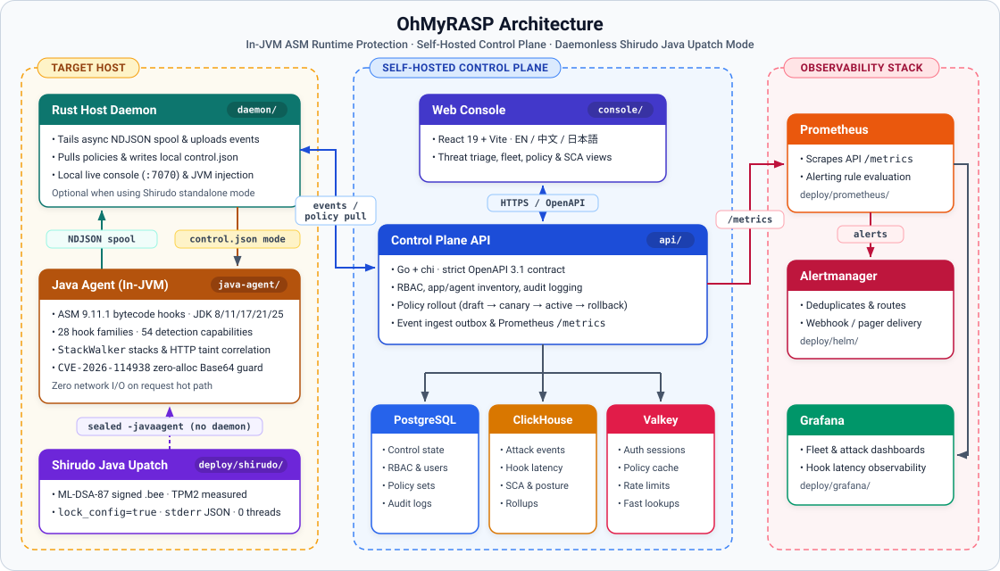

# Architecture

OhMyRASP protects Java applications inside the JVM while keeping telemetry, control-plane management, and analytics decoupled from the request hot path.

## Components

| Component | Path | Toolchain | Role |
|---|---|---|---|
| Java agent | `java-agent/` | Gradle on JDK 25 (builder image pinned in `java-agent/Dockerfile`), ASM (version in each `agent-*/build.gradle.kts`) | Instruments JDK sinks via `-javaagent`, inspects runtime context, blocks or logs attacks, and emits NDJSON events. |
| Host daemon | `daemon/` | Rust (toolchain pinned in `daemon/rust-toolchain.toml`, edition 2024) | Tails the agent NDJSON spool, writes `control.json`, serves a local `:7070` console, and forwards events to the control plane with offline buffering. |
| Control-plane API | `api/` | Go (version pinned in `api/go.mod`, builder image in `api/Dockerfile`) | Serves the OpenAPI 3.1 REST API (`ohmyrasp-api`), runs DB migrations (`ohmyrasp-migrate`), manages RBAC/policies/audit logs, and exports `/metrics`. |
| Web console | `console/` | React, TypeScript, Vite, Tailwind CSS (versions in `console/package.json`) | Application-centric operator UI served behind nginx on `:8080`, proxying `/api/` same-origin to the Go API. |

### Java agent (`java-agent/`)

The agent ships several tracks targeting distinct JVM bytecode levels, each shading OW2 ASM under `io.ohmyrasp.agent.shaded.asm` so bootstrap classloader injection never collides with an application's own ASM version:

- `agent-jdk25` (`ohmyrasp-agent.jar`; also published as `ohmyrasp-agent-jdk21.jar`): primary track for Java 21 and 25, with the full set of ASM hook modules, detector capabilities, and algorithm signatures asserted in the acceptance scripts listed in [DETECTION-COVERAGE.md](../java-agent/docs/DETECTION-COVERAGE.md) (generated).
- `agent-java17` (`ohmyrasp-agent-java17.jar`): backport for Java 17 and Java 21.
- `agent-java11` (`ohmyrasp-agent-java11.jar`): backport for Java 11.
- `agent-java8` (`ohmyrasp-agent-java8.jar`): backport for Java 8.

Detection is signature-based with request-parameter substring correlation (`ThreadLocal<RequestContext>`) and `StackWalker` call-stack analysis rather than bytecode dataflow taint tracking. Hot-path hooks make no outbound network calls; `JsonEventLogger` queues findings on a background writer thread (or writes synchronously to `stderr` in shirudo standalone mode). See [Agent](agent.md) and [Detection](detection.md).

### Host daemon (`daemon/`)

`ohmyrasp-daemon` separates host-side telemetry, policy transport, and local operator visibility from the protected JVM:

- Tails the agent's NDJSON spool (`tailer.rs`) with polling so rotation, truncation, and split multibyte lines are handled without platform watch quirks.
- Keeps a bounded in-memory event ring and latency reservoir (`store.rs`) backing the single-page embedded console (`console.rs` and `dashboard.html`, bound to `127.0.0.1:7070` by default).
- Owns `control.json` (`control.rs`) for mode (`off`, `monitor`, `block`), per-algorithm toggles, and cloud-assigned policy distribution.
- Optionally registers with `/api/v1`, sends heartbeats, pulls policies, and uploads enriched detections via `CloudClient` and `Uploader` (`cloud.rs`, `uploader.rs`).

See [Host Daemon](../daemon/README.md) for flags, configuration, and HTTP routes.

### Control-plane API (`api/`)

The Go backend (`cmd/ohmyrasp-api`) uses `net/http`, `chi`, structured `slog` JSON logging, and `oapi-codegen` strict-server bindings generated from `api/openapi.yaml` (`internal/generated`). Core responsibilities:

- Authentication, RBAC enforcement, application/environment inventory, secret rotation, and audit logging.
- Policy set lifecycle (draft rules, validation, simulation, immutable version promotion, canary rollout, rollback) and agent registration, heartbeats, and policy pulls.
- Ingestion and filtered queries for security events (plus soft-delete/restore/purge recycle bin), dependency inventory, baseline findings, and runtime overhead reports.
- Daemon management (`/api/v1/daemon/*` plus legacy aliases `/v1/service/dl/agent` and `/v1/service/command` LZ4 websocket), operator agent-artifact catalog/upload (`OHMYRASP_AGENT_ARTIFACT_DIR`), maintenance cleanup, and alert rule evaluation.
- Background workers (`AlertDeliveryWorker` and `EventOutboxWorker`) and Prometheus exposition at `/metrics` (optionally protected by `OHMYRASP_METRICS_TOKEN`).

See [API Reference](api-reference.md) for endpoints and runtime configuration.

### Web console (`console/`)

The React console scopes views by a global application and optional environment selector (`src/lib/app-context.ts`). All user-facing strings use `t()` with English-as-key dictionaries (`zh` and `ja` translations verified by `npm run i18n:check`), and styling uses dark/light CSS tokens (`src/styles.css`). See [Console](console.md).

## Deployment Topologies

| Topology | Components | Control & Telemetry Path | Primary Use Case |
|---|---|---|---|
| Full control plane | Java agent + Host daemon (or direct agent uplink) + `api` + `console` + PostgreSQL, ClickHouse, Valkey, Prometheus/Alertmanager/Grafana | Agent -> `events.jsonl` -> Daemon -> `/api/v1` -> PostgreSQL + ClickHouse; Policy -> Daemon -> `control.json` -> Agent | Multi-host production fleets with central policy rollout, RBAC, audit logs, and analytics. |
| Host daemon local-only | Java agent + Host daemon (`cloud.enabled = false`) | Agent -> `events.jsonl` -> Daemon `:7070` console; Operator -> Daemon -> `control.json` -> Agent | Single-host deployments, air-gapped environments, or local latency/attack evaluation. |
| Standalone / shirudo daemonless | Shirudo upatch JARs (the universal `ohmyrasp.jar`, or one per JDK track for a host pinned to one Java version; see the asset list in the [Release runbook](runbooks/release.md)) packaged via `deploy/shirudo/` | Zero background threads; baked `META-INF/ohmyrasp-shirudo.properties`; JSON detections emitted to `stderr` | Immutable, ML-DSA-87-signed, TPM2-measured [shirudo](https://github.com/shirudo-dev/shirudo) targets without a daemon or control plane. |

In the shirudo daemonless topology, `shirudoUpatchJar` and `verifyShirudoUpatchJar` build and check the standalone JARs (`standalone=true`, `lock_config=true`, `mode=block`, `control=none`, `log=stderr`, `latency_sample=0`) packaged as `.bee` archives. On a shirudo target, `shirudo` verifies the ML-DSA-87 signature against the sealed `.bpf` keyring, extends the TPM2 register, seals the JAR under `/run/shirudo-java/<name>.jar`, and writes `/run/environment.d/shirudo.conf`. Because a Java agent operates inside user-space JVMs rather than at the kernel boundary, `root` or the launching user can still bypass `JAVA_TOOL_OPTIONS` or `-javaagent`; kernel-level enforcement requires BPF upatches. See [Shirudo Java Upatches](../deploy/shirudo/README.md).

## Agent-to-Daemon Local File Contract

When the agent and host daemon run together, they communicate solely through two host-local files with no RPC or socket dependency between them:

1. **Event spool (`events.jsonl`, default `/tmp/ohmyrasp-events.jsonl`)**:
   - Written asynchronously (append-only NDJSON) by `JsonEventLogger`.
   - The fields of a line, with the redaction of sensitive headers and parameters, are shown by the example lines in [`java-agent/contracts/agent-daemon/events/`](../java-agent/contracts/agent-daemon/README.md#files), which the agents' tests produce and the daemon's tests parse. The backport agents write a smaller line than the primary one: `"event":"ohmyrasp-detection"` and a numeric epoch-millisecond `timestamp` instead of `kind` and an ISO string, and a separate start line. The daemon classifies a line by `kind`, or by its `event` and fields when it has none; only a detection is logged, counted and uploaded, a start line only fills the `agent` entry of `/api/stats`, and any other kind is counted as ignored. The [fixtures' README](../java-agent/contracts/agent-daemon/README.md#how-the-daemon-reads-a-line) has the table.
   - `telemetry` lines feed only the daemon's local latency percentile panel (`p50`/`p95`/`p99`/`max`/`avg`) and are never forwarded to the control plane.
   - Trade-off: `tailer.rs` does not persist its byte offset across daemon restarts; starting without `--from-start` resumes from current EOF (missing events written while the daemon was down), while `--from-start` replays the full file.
2. **Control file (`control.json`, default `/tmp/ohmyrasp-control.json`)**:
   - Owned by the daemon (`control.rs`) and polled by `AgentRuntime` without restarting the JVM.
   - The document is a JSON object: `mode`, per-algorithm switches (a switch set to `false` disables an algorithm; absent means enabled), an optional `policy` that carries the raw cloud-assigned policy as a string and is left out once the daemon withdraws it, a monotonic `revision`, and `updated_at`. The example documents in [`java-agent/contracts/agent-daemon/control/`](../java-agent/contracts/agent-daemon/README.md#files) are written by the daemon's `Controller` and read through the agents' production pollers; `control/rejected/` holds documents the agents must ignore. The backport agents read only `mode`. Both agent engines accept the same spellings of it (`record`, `protect` and the other aliases, in any letter case), and the daemon reads them from a hand-edited file and rewrites the canonical word. Both agent engines ignore a document larger than the limit in [`control/limits.properties`](../java-agent/contracts/agent-daemon/control/limits.properties), so the daemon refuses to write a larger one (a large cloud policy, for instance): it keeps the previous document, logs the size and the limit, and reports `control_status.write_refused` in `/api/stats`. The size is measured on the file as found at start-up: a padded file the agents were ignoring is written again when its document fits (`control_status.oversized_file_replaced`), and when it does not fit the refusal says the agents are not applying the daemon's in-memory state (`agents_apply_state` is false).
   - Written atomically via `<control>.json.tmp` + `rename` with Unix permissions restricted to `0600` (`util::restrict_to_owner`).

A change to either format is made by regenerating those examples and reviewing the diff, as the [fixtures' README](../java-agent/contracts/agent-daemon/README.md) describes: the other side's tests then show what else has to change.

When the cloud uplink is unreachable or disabled, `uploader.rs` holds detections in a bounded in-memory queue (`buffer.max_pending`, default `10000`, evicting oldest on overflow) and writes pending raw events to `<buffer.dir>/outbox.ndjson` (also restricted to `0600`) on graceful shutdown; a hard crash (`SIGKILL` or power loss) before shutdown drops events still in memory. If the daemon is absent, the agent continues protecting the JVM and appending to its local log.

## Storage Boundaries

The control plane splits durable state, analytics, and volatile cache across three backing stores (images pinned in `docker-compose.yml` and `.github/docker-compose.ci-services.yml`; storage code in `api/internal/storage/`):

| Store | Image | Owns | Durability & Failure Behavior |
|---|---|---|---|
| **PostgreSQL** | `postgres` | Organizations, users, hashed sessions, applications and secrets, environments, agents, daemon workloads/injection state, policy sets and immutable promoted versions, dependency inventory, baseline findings, settings, alert rules/deliveries, audit logs, and `event_ingest_outbox`. | Authoritative system of record (`api/internal/storage/migrations/postgres/`). Isolated local experiments can run with `OHMYRASP_STORE=memory`. |
| **ClickHouse** | `clickhouse/clickhouse-server` | Append-optimized security events, hook/performance/crash detail tables, dependency observations, and rule-overhead rollups (`api/internal/storage/migrations/clickhouse/`). | If ClickHouse is temporarily unreachable, the API writes incoming events to PostgreSQL `event_ingest_outbox` and `EventOutboxWorker` drains them when ClickHouse recovers. |
| **Valkey** | `valkey/valkey` | Cached user sessions (`ohmyrasp:session:*`), epoch-versioned agent policy cache (`ohmyrasp:agent-policy:*`), and fixed-window rate-limit counters (`ohmyrasp:ratelimit:*`, default `600` req/`1m`). | Volatile cache only (`api/internal/storage/valkey/cache.go`). Rebuildable from PostgreSQL and live traffic; policy mutations bump the cache epoch to invalidate stale entries. |

Uploaded Java agent ZIP artifacts are stored on disk under `OHMYRASP_AGENT_ARTIFACT_DIR` (`/var/lib/ohmyrasp/artifacts` in Compose and the `artifact-pvc` volume in Helm).

## RBAC and Audit Boundaries

Access control (`api/internal/control/types.go`, `api/internal/httpapi/rbac.go`) separates human operators from workload/agent callers:

- **Human roles**:
  - `viewer`: read access across applications, agents, daemon inventory, policies, events, analytics, settings, alert rules/deliveries, and audit logs.
  - `security_engineer`: all `viewer` permissions plus managing applications (including secret rotation), agents, daemon bindings/artifacts, policies/evaluation, event lifecycle (including recycle bin), settings, and alert rules.
  - `admin`: all `security_engineer` permissions plus user account reads and administration (`users:read`, `users:manage`). Disabling a user revokes sessions in both PostgreSQL and Valkey.
- **Machine credentials**:
  - Agent and application endpoints require `X-OhMyRasp-App-ID` and `X-OhMyRasp-App-Secret`.
  - Daemon inventory, artifact download, and command endpoints authenticate with rotated daemon tokens.
  - `/metrics` is unauthenticated unless `OHMYRASP_METRICS_TOKEN` is set (`Authorization: Bearer <token>`).
- **Audit trail**: mutating operations on users, applications, secrets, environments, daemon tokens/workloads, agents, policies, agent artifact uploads, settings, maintenance cleanup (`CLEAR_OPERATIONAL_DATA` confirmation required), alert rules, and event recycle-bin/ingest paths emit `RecordAuditLog` entries persisted in PostgreSQL.

## Related Documentation

- [Getting Started](getting-started.md): pre-built releases, Docker Compose setup, and live verification
- [Agent](agent.md): Java agent internals, hooks, and the JDK tracks
- [Detection](detection.md): five-stage detection pipeline, capabilities, and false-positive testing
- [Host Daemon](../daemon/README.md): Rust daemon CLI, config, and local console API
- [Console](console.md): React UI architecture, screens, and verification
- [API Reference](api-reference.md): Go control-plane endpoints, migrations, and store modes
- [Shirudo Java Upatches](../deploy/shirudo/README.md): daemonless `.bee` packaging and target boundaries
- Operations runbooks: [Backup and Restore](runbooks/backup-restore.md), [Helm Production](runbooks/helm-production.md), [Observability](runbooks/observability.md), [Release](runbooks/release.md), [Upgrade and Downgrade](runbooks/upgrade-downgrade.md)
- Coverage ledgers: [Algorithm Coverage](development/algorithm-coverage.md), [Vulhub Coverage](development/vulhub-coverage.md)
